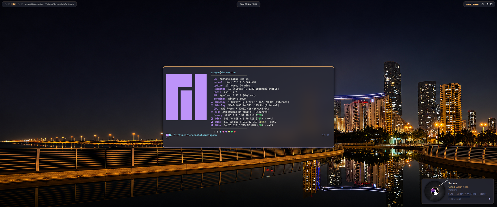
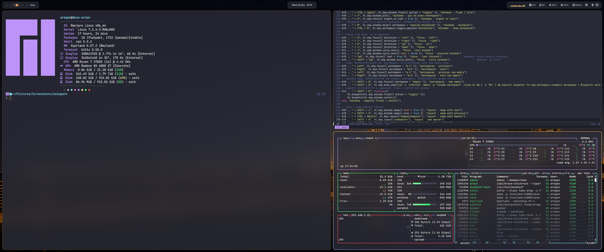
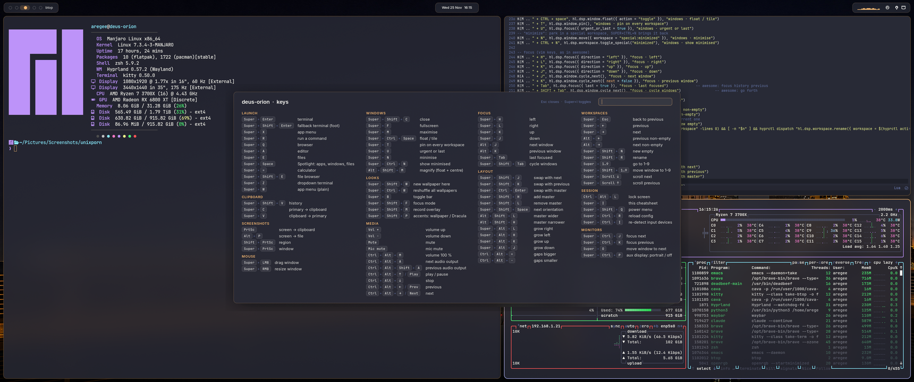
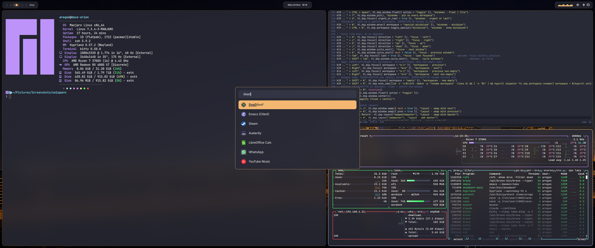

# dotfiles · deus-orion

Manjaro · **Hyprland 0.57 (Lua config)** · Waybar · rofi · mako · kitty · zsh + Powerlevel10k · Dracula

Bare git repo checked out over `$HOME` (`alias dotfiles='git --git-dir=$HOME/.dotfiles --work-tree=$HOME'`).

## Screens

| | |
|---|---|
|  kitty · Doom Emacs · btop, metrics drawer open in the bar |  `SUPER+I` keybind sheet, drawn from the binds' own descriptions |
|  Spotlight-style rofi | the 40 s clip: `~/Videos/unixporn/final-master.mp4` (not in the repo) |

## What is different here

- **Accents follow the wallpaper, per workspace.** Every workspace has its own wallpaper
  (`.config/hypr/wallpaper.sh`, crossfade via awww). `palette.py` pulls two hues from each picture;
  on a workspace switch `hyprland.lua` reads the cached palette and recolours the border gradient in
  the same frame (angle turns 45° per workspace), and the script pushes the same accents into Waybar,
  kitty, rofi, mako and hyprlock through small include files with live reloads.
  `SUPER+SHIFT+P` snaps back to plain Dracula.
- **Lua-only behaviour** in `hyprland.lua`: no border on a workspace with a single window, unfocused
  windows dim after 22:00, `SUPER+SHIFT+F` focus mode (no gaps, square, thin borders, bar hidden).
- **Per-screen tags, like awesome.** The side panel owns workspaces 11-19; `SUPER+n` acts on the screen
  that has focus, each screen renders its own wallpaper (the panel from `Wallpapers/vertical`), and the
  theme only ever follows the main display. Master layout in centre orientation (awesome centerwork).
- **DeaDBeeF now-playing overlay** (`now-playing.py`, GTK + gtk-layer-shell + cairo): a record spinning
  at 33⅓ with the cover as its label, a tonearm that tracks the position, and the real stream format
  read with ffprobe (DSD64 · 2.82 MHz · 1-bit, FLAC · 24-bit / 96 kHz …). Shows itself while music
  plays; `SUPER+SHIFT+M` toggles it; click pauses, scroll skips.
- **Waybar** (`.config/waybar/`): floating three-island bar, cava visualiser and now-playing modules.
- **rofi** (`.config/rofi/`): Spotlight-style combi launcher with a cached file index, power menu.

## Keys worth knowing

| key | does |
|---|---|
| `SUPER+Space` | Spotlight: apps + windows + files |
| `SUPER+Z` | dropdown terminal |
| `SUPER+SHIFT+W` / `SUPER+CTRL+W` | new wallpaper for this workspace / reshuffle all |
| `SUPER+SHIFT+F` | focus mode |
| `SUPER+SHIFT+M` | now-playing overlay |
| `SUPER+SHIFT+Q` | power menu |
| `SUPER+I` | keybind cheatsheet (type to filter, Esc closes) |
| `SUPER+CTRL+P` | aux display (HDMI-A-1) on in portrait / off; off by default |
| `ALT+CTRL+A` / `ALT+CTRL+SHIFT+A` | next / previous audio output (AirPlay, USB DAC, Odyssey, aux panel), moves playing streams along |

## Lineage

Where it all started, awesome 3.5 and a dual-head multicolor theme: https://github.com/aregee/awesome-wm
Where it ended up: this repo. The ten years in between live on the `legacy-x11` branch.
Same four habits the whole way: a dropdown terminal, rotating wallpapers, per-screen tags, a lock screen. Only the compositor changed.

## Not in the repo

Dracula GTK theme (`~/.themes`), Bibata cursor (`~/.icons`), wallpapers (`~/Pictures/Wallpapers`).
The `accent.*` files and `hyprlock-accent.conf` are generated at runtime; the committed ones are the plain Dracula defaults
and are marked `skip-worktree`, so they never show up as modified.

The `legacy-x11` branch was started from someone else's dotfiles in 2017 and carries their identity and theme wallpapers; nothing on master comes from it.
